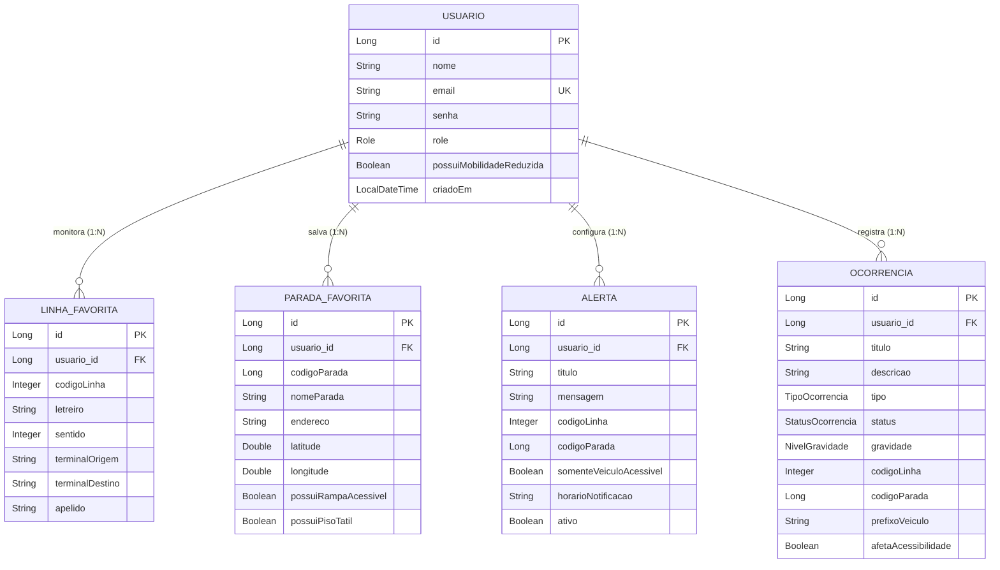

# ViaCidadã API — Global Solution FIAP 2026/2 (CitizenTech)

> **Disciplina:** Java Advanced | **Tema:** CitizenTech — Mobilidade Urbana Acessível e Participação Cidadã

API RESTful em **Java 21 + Spring Boot 3.4.5** que sustenta a solução **ViaCidadã**, conectando cidadãos (especialmente Pessoas com Deficiência — PcD e usuários com mobilidade reduzida) a informações de transporte público em tempo real (API **Olho Vivo da SPTrans** + geocodificação **OpenStreetMap**), planejamento inteligente de rotas e registro colaborativo de ocorrências de acessibilidade.

O backend atua como camada segura para o aplicativo mobile em Flutter ([gs-mobile-flutter](https://github.com/GS-EDUeAMIGOS/gs-mobile-flutter)), garantindo que a chave da SPTrans (`SPTRANS_TOKEN`) permaneça protegida em variável de ambiente no servidor.

---

## 1. Equipe, Pitch e Conexão com os ODS da ONU

### Integrantes do Grupo

| Nome Completo | RM | Turma |
|---|---|---|
| Alisson Kawan Evangelista Silva | 567598 | 2TDS |
| Kenji Fernandes Wakabayashi | 568156 | 2TDS |
| Erick Ramos Santos | 567837 | 2TDS |
| Eduardo Boni dos Santos | 567236 | 2TDS |
| Marcos Vinicius de Jesus Almeida | 567214 | 2TDS |

### Vídeo Pitch (até 5 minutos)
- **Link do Pitch (YouTube / Drive):** *(Inserir link público ou não listado após gravação)*

### Conexão com os ODS da Agenda 2030 (ONU)
- **ODS 10 — Redução das Desigualdades:** Amplia a autonomia de pessoas com deficiência (PcD) e mobilidade reduzida ao sinalizar ônibus com elevador acessível e ocorrências críticas de acessibilidade em paradas e veículos.
- **ODS 11 — Cidades e Comunidades Sustentáveis (Meta 11.2):** Facilita o acesso a sistemas de transporte seguros, acessíveis e sustentáveis por meio de previsão de chegada em tempo real, planejamento multimodal de rotas e zeladoria cidadã.

---

## 2. Arquitetura e Pacotes

```text
br.com.viacidada
 ├─ config          # Configurações de Cache, OpenAPI/Swagger e DataSeeder (H2)
 ├─ controller      # Endpoints RESTful com paginação, ordenação, RBAC e links HATEOAS
 ├─ service         # Regras de negócio, @Cacheable e @CacheEvict
 ├─ repository      # Interfaces Spring Data JPA (Query Methods, @Query JPQL e Specification)
 ├─ entity          # Entidades JPA, relacionamentos 1:N e Enums de domínio
 ├─ dto             # Objetos de transferência de dados com Bean Validation e HATEOAS
 ├─ mapper          # Conversão entre Entidades e DTOs (DomainMapper)
 ├─ exception       # Tratamento global de erros padronizado (@RestControllerAdvice)
 ├─ security        # Autenticação Stateless com JWT, BCrypt, papéis (ROLE_CIDADAO/ROLE_ADMIN) e CORS
 ├─ client          # Clientes HTTP para SPTrans Olho Vivo e OpenStreetMap Nominatim
 └─ specification   # Filtros dinâmicos com JPA Criteria/Specification
```

---

## 3. Modelagem de Domínio e Diagrama de Entidades

A solução possui 5 entidades principais com relacionamentos `1:N` a partir de `Usuario`:



### Justificativa da Modelagem (`cascade`, `fetch` e DTOs)
- **`FetchType.LAZY` no lado `@ManyToOne`:** Evita carregar o objeto `Usuario` inteiro em consultas onde apenas os dados da ocorrência, linha, parada ou alerta são necessários, prevenindo o problema de consultas N+1.
- **`CascadeType.ALL` com `orphanRemoval = true` no lado `@OneToMany`:** Garante integridade referencial no ciclo de vida dos dependentes quando um usuário é removido por um administrador.
- **DTOs separados (`Request` / `Response`) + `DomainMapper`:** Protege campos sensíveis da entidade (como `senha` hash BCrypt) e evita exposição direta do modelo relacional no contrato JSON da API.

---

## 4. Justificativa das Consultas, Filtros Dinâmicos e Cache

### Por que cada tipo de consulta foi escolhido?
1. **Query Methods Derivados** (consultas simples por igualdade/ordenação/paginação):
   - `UsuarioRepository.findByEmailIgnoreCase(String email)` — login e checagem de duplicidade sem case-sensitivity.
   - `LinhaFavoritaRepository.findByUsuarioId(Long usuarioId, Pageable pageable)` — listagem paginada por usuário.
   - `ParadaFavoritaRepository.findByUsuarioIdAndPossuiRampaAcessivelTrue(Long usuarioId)` — filtro direto de paradas acessíveis.
   - `AlertaRepository.findByUsuarioIdAndAtivoTrue(Long usuarioId)` — alertas ativos do cidadão.
   - `OcorrenciaRepository.findByStatus(StatusOcorrencia status, Pageable pageable)` — listagem paginada por status.
2. **Consultas `@Query` com JPQL** (regras de negócio com múltiplos critérios, `LIKE`, `JOIN` ou parâmetros opcionais):
   - `UsuarioRepository.buscarPorPerfilEAcessibilidade(Role, Boolean, Pageable)` — filtro administrativo combinando papel e mobilidade reduzida.
   - `LinhaFavoritaRepository.buscarFavoritasPorTermo(Long, String)` — busca case-insensitive por letreiro, apelido ou terminal.
   - `ParadaFavoritaRepository.buscarParadasAcessiveisDoUsuario(Long)` — paradas com rampa **ou** piso tátil (`OR`).
   - `AlertaRepository.buscarAlertasAtivosPorLinhaOuParada(Integer, Long)` — alertas ativos associados a uma linha ou parada.
   - `OcorrenciaRepository.buscarOcorrenciasCriticasAcessibilidade(List<StatusOcorrencia>, TipoOcorrencia)` — ordenação priorizada por gravidade e data para o painel crítico.
3. **Filtros Dinâmicos com `Specification`** (`OcorrenciaSpecification.comFiltros(...)`):
   - Em `GET /api/ocorrencias`, o cidadão ou o app Mobile pode combinar qualquer subconjunto de 7 parâmetros opcionais (`tipo`, `status`, `gravidade`, `codigoLinha`, `codigoParada`, `afetaAcessibilidade`, `termo`). Usar `JpaSpecificationExecutor` evita criar dezenas de métodos `findBy...` combinatórios no repositório.

### Estratégia de Cache (`@Cacheable` e `@CacheEvict`)
- **`linhasSptrans` e `paradasSptrans`:** Cacheiam buscas textuais de linhas (`GET /api/linhas`) e paradas (`GET /api/paradas`, `GET /api/linhas/{codigo}/paradas`), que mudam com baixa frequência, reduzindo latência e requisições à API externa da SPTrans. Possuem invalidação manual administrativa em `DELETE /api/sptrans/cache`. *Posições de veículos em tempo real (`/veiculos`) e previsões (`/previsoes`) NÃO são cacheadas para manter precisão ao vivo.*
- **`ocorrencias`:** Cacheia `GET /api/ocorrencias/acessibilidade-criticas` (consultado na tela inicial do app) e é invalidado automaticamente (`@CacheEvict(allEntries = true)`) em toda operação de escrita (`POST`, `PUT`, `DELETE`).
- **`alertas`:** Cacheia `GET /api/alertas/ativos` e invalida automaticamente ao criar, atualizar ou excluir alertas.

---

## 5. Segurança (JWT, Papéis/RBAC e CORS)

- **Autenticação Stateless com JWT (`jjwt`) + BCrypt:** `POST /api/auth/register` e `POST /api/auth/login`.
- **Autorização por Papel (RBAC):**
  - `ROLE_ADMIN`: Acesso exclusivo a `GET /api/usuarios`, `DELETE /api/usuarios/{id}` e `DELETE /api/sptrans/cache`.
  - `ROLE_CIDADAO` e `ROLE_ADMIN`: Acesso às operações de criação, edição e exclusão de ocorrências, linhas favoritas, paradas favoritas e alertas.
  - Endpoints públicos de consulta (`GET /api/linhas/**`, `GET /api/paradas/**`, `GET /api/locais/**`, `GET /api/rotas/**`, `GET /api/ocorrencias/**`, Swagger e Actuator).
- **CORS:** Configurado em `SecurityConfig` para permitir consumo pelo aplicativo Flutter Web/Mobile.

### Usuários de Teste (Perfil `h2`)

Criados automaticamente pelo `DataSeederConfig` ao iniciar com o perfil padrão `h2`:

| Papel | E-mail | Senha | Perfil |
|---|---|---|---|
| `ROLE_CIDADAO` | `cidadao@viacidada.com.br` | `Cidadao@123` | Cidadão com mobilidade reduzida (PcD) |
| `ROLE_ADMIN` | `admin@viacidada.com.br` | `Admin@123` | Administrador do sistema |

---

## 6. Como Executar e Testar

### Pré-requisitos
- **Java 21+**
- Maven Wrapper incluso (`.\mvnw.cmd` no Windows ou `./mvnw` no Linux/macOS)

### Variáveis de Ambiente (Opcional / Recomendado)
Consulte [`.env.example`](.env.example). Nenhuma credencial real é versionada no repositório.
- `SPTRANS_TOKEN`: Token da API Olho Vivo SPTrans (necessário para consultas reais em `/api/linhas`, `/api/paradas` e `/api/rotas/planejar`).
- `JWT_SECRET`: Chave secreta HMAC-SHA256 para assinatura JWT (há valor de desenvolvimento local no `application.yml`).
- `SPRING_PROFILES_ACTIVE`: `h2` (padrão) ou `oracle` (exige `ORACLE_DB_URL`, `ORACLE_DB_USERNAME`, `ORACLE_DB_PASSWORD`).

### Comandos

```powershell
# 1. Compilar e rodar todos os testes automatizados (perfil test)
.\mvnw.cmd test

# 2. Subir a API localmente no perfil H2 (padrão)
$env:SPTRANS_TOKEN="SEU_TOKEN_AQUI"
.\mvnw.cmd spring-boot:run

# 3. (Opcional) Testar conectividade e subir com o banco Oracle da FIAP (lendo .env)
.\scripts\test-oracle.ps1
. .\scripts\load-env.ps1
.\mvnw.cmd spring-boot:run
```

### Endpoints de Documentação, Observabilidade e HATEOAS
- **Swagger UI:** `http://localhost:8080/swagger-ui.html`
- **OpenAPI JSON:** `http://localhost:8080/v3/api-docs`
- **Actuator Health:** `http://localhost:8080/actuator/health`
- **Actuator Info:** `http://localhost:8080/actuator/info`
- **Actuator Metrics:** `http://localhost:8080/actuator/metrics`
- **H2 Console:** `http://localhost:8080/h2-console` (`jdbc:h2:mem:viacidadadb`, usuário `sa`, senha vazia)

---

## 7. Repositórios Relacionados da GS
- [gs-mobile-flutter](https://github.com/GS-EDUeAMIGOS/gs-mobile-flutter) — Mobile Application Development (App Flutter integrado a esta API)
- [gs-dotnet-api](https://github.com/GS-EDUeAMIGOS/gs-dotnet-api) — Advanced Business Development with .NET
- [gs-arquitetura-qa](https://github.com/GS-EDUeAMIGOS/gs-arquitetura-qa) — Compliance, Quality Assurance & Tests
- [gs-devops-cloud](https://github.com/GS-EDUeAMIGOS/gs-devops-cloud) — DevOps Tools & Cloud Computing
- [gs-iot-redes](https://github.com/GS-EDUeAMIGOS/gs-iot-redes) — Disruptive Architectures: IoT, IoB & Generative IA
- [gs-database](https://github.com/GS-EDUeAMIGOS/gs-database) — Mastering Relational and Non-Relational Database

---

## 8. Declaração de Uso de IA Generativa

Em conformidade com as diretrizes acadêmicas da **Global Solution FIAP**, declaramos de forma transparente como ferramentas de Inteligência Artificial Generativa foram utilizadas no ciclo de engenharia deste projeto:

1. **Planejamento Arquitetural guiado por Engenharia de Software:**
   - Utilizamos conceitos formais de Engenharia de Software (arquitetura em camadas, separação de responsabilidades — SRP/SOLID, modelagem relacional `1:N`, especificação de contratos RESTful, DTOs e segurança Stateless com JWT) para estruturar e planejar a solução em conjunto com assistentes de IA.
2. **Implementação Otimizada com Modelos de Menor Custo:**
   - Após a definição arquitetural e validação dos requisitos de domínio pela equipe, modelos mais leves e econômicos foram empregados como apoio produtivo na geração de *boilerplate*, escrita de testes automatizados (`MockMvc`), diagnóstico de erros de configuração (como variáveis de ambiente e integração JDBC Oracle) e revisão textual da documentação.
3. **Revisão Crítica, Decisão Humana e Responsabilidade Técnica:**
   - **Nenhum código foi entregue sem compreensão ou validação.** Cada classe, consulta (`Query Methods`, `@Query` JPQL e `Specification`), política de cache (`@Cacheable`/`@CacheEvict`) e regra de segurança foi revisada, testada e aprovada pelos integrantes do grupo, que detêm pleno domínio do funcionamento e assumem total responsabilidade técnica pelas decisões adotadas no projeto.
