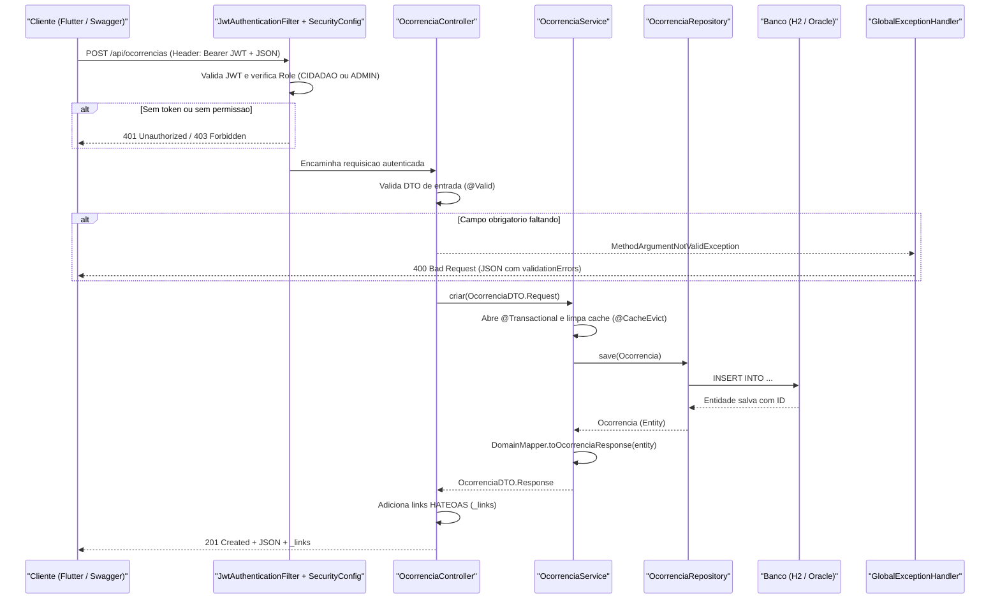

# Guia Completo de Estudos — Backend Java (ViaCidadã API)

> **Para quem é este guia?**  
> Para toda a equipe do **ViaCidadã** estudar a arquitetura do backend em **Java 21 + Spring Boot**, entender **onde está cada arquivo**, **por que cada decisão técnica foi tomada**, **como defender o projeto para os professores** e **como testar tudo no Swagger passo a passo**.

---

## Sumário

1. [Visão Geral e Tecnologias](#1-visão-geral-e-tecnologias)
2. [A Analogia do Restaurante (Arquitetura em Camadas)](#2-a-analogia-do-restaurante-arquitetura-em-camadas)
3. [Mapa Completo das Pastas e Arquivos](#3-mapa-completo-das-pastas-e-arquivos)
4. [Fluxo Completo de uma Requisição (Do Início ao Fim)](#4-fluxo-completo-de-uma-requisição-do-início-ao-fim)
5. [Glossário das Anotações do Spring que Aparecem no Código](#5-glossário-das-anotações-do-spring-que-aparecem-no-código)
6. [Perfis de Banco de Dados (H2, Test e Oracle)](#6-perfis-de-banco-de-dados-h2-test-e-oracle)
7. [Testes Automatizados](#7-testes-automatizados)
8. [Como Usar o Swagger na Prática (Passo a Passo)](#8-como-usar-o-swagger-na-prática-passo-a-passo)
9. [Top 10 Perguntas de Professores (E Como Responder)](#9-top-10-perguntas-de-professores-e-como-responder)
10. [Sugestão de Divisão da Apresentação em Grupo](#10-sugestão-de-divisão-da-apresentação-em-grupo)

---

## 1. Visão Geral e Tecnologias

O **ViaCidadã API** é uma API RESTful voltada para **CitizenTech e mobilidade urbana acessível**, consumida pelo aplicativo mobile/web em Flutter e integrada à API pública **SPTrans Olho Vivo** e **OpenStreetMap (Geocoding)**.

**Principais tecnologias utilizadas:**
- **Java 21 + Spring Boot**: base da aplicação web.
- **Spring Web (MVC)**: exposição dos endpoints REST (`/api/...`).
- **Spring Security + JWT + BCrypt**: autenticação stateless (sem sessão no servidor) e controle de acesso por perfil (`ROLE_CIDADAO` e `ROLE_ADMIN`).
- **Spring Data JPA + Hibernate + Specification**: persistência em banco relacional (H2 em desenvolvimento/testes e Oracle em produção/faculdade) com filtros dinâmicos e paginação.
- **Bean Validation (`@Valid`)**: validação automática dos campos recebidos em JSON.
- **Spring Cache (`@Cacheable` / `@CacheEvict`)**: cache em memória para acelerar consultas repetitivas.
- **Spring HATEOAS**: inclusão automática de links navegáveis (`_links`) nas respostas JSON.
- **Springdoc OpenAPI (Swagger UI)**: documentação interativa para testar todos os endpoints pelo navegador.
- **Lombok**: reduz código repetitivo (`@Getter`, `@Builder`, `@RequiredArgsConstructor`, `@Slf4j`).

---

## 2. A Analogia do Restaurante (Arquitetura em Camadas)

Nosso código segue a **Arquitetura em Camadas** respeitando o princípio **SRP (Single Responsibility Principle — Responsabilidade Única)**: cada pasta tem **uma única função**.

Se você precisar explicar a estrutura de forma simples, use a analogia de um **restaurante**:

| Camada (Pasta) | Analogia | O que ela faz no ViaCidadã |
| :--- | :--- | :--- |
| **`security`** | **Portaria / Segurança** | Confere o crachá (Token JWT) na entrada e verifica se a pessoa é `CIDADAO` ou `ADMIN`. |
| **`controller`** | **Garçom** | Recebe o pedido HTTP (GET, POST, PUT, DELETE), valida o formato (`@Valid`) e entrega o prato pronto com links HATEOAS. **Não tem regra de negócio.** |
| **`dto`** | **Cardápio e Comanda** | Define exatamente o que entra (`Request`) e o que sai (`Response`) na API, sem expor as tabelas internas do banco. |
| **`service`** | **Chef de Cozinha** | Executa as regras de negócio, abre transações (`@Transactional`) e gerencia o cache (`@Cacheable` / `@CacheEvict`). |
| **`mapper`** | **Empratamento** | Converte a entidade interna do banco (`Entity`) no `DTO.Response` seguro para o cliente. |
| **`specification`** | **Montador de Filtros** | Monta dinamicamente o `WHERE` da busca SQL conforme os filtros opcionais enviados na URL. |
| **`repository`** | **Almoxarifado / Estoque** | Fala diretamente com o banco de dados (salvar, buscar, deletar, JPQL). |
| **`entity`** | **Molde das Tabelas** | Classes Java anotadas com `@Entity` que espelham as tabelas do banco e os `enum`s de domínio. |
| **`client`** | **Fornecedores Externos** | Faz chamadas HTTP para APIs externas (SPTrans Olho Vivo e OpenStreetMap). |
| **`exception`** | **Gerente de Crise** | Captura qualquer erro da aplicação e devolve um JSON limpo com o status HTTP correto (`400`, `401`, `403`, `404`, `409`, `502`). |
| **`config`** | **Infraestrutura da Casa** | Configura o Swagger (`OpenApiConfig`), o Cache (`CacheConfig`) e os dados iniciais de demonstração (`DataSeederConfig`). |

---

## 3. Mapa Completo das Pastas e Arquivos

Todo o código Java principal fica em `src/main/java/br/com/viacidada/`.

### Ponto de Entrada
- [`ViaCidadaApplication.java`](../src/main/java/br/com/viacidada/ViaCidadaApplication.java) — Classe com o método `main()` que liga o Spring Boot (`@SpringBootApplication`) e ativa o sistema de cache (`@EnableCaching`).

### 3.1. `controller/` — Endpoints REST
- [`AuthController.java`](../src/main/java/br/com/viacidada/controller/AuthController.java) — Cadastro (`/api/auth/register`) e Login (`/api/auth/login`).
- [`OcorrenciaController.java`](../src/main/java/br/com/viacidada/controller/OcorrenciaController.java) — Ocorrências cidadãs (`/api/ocorrencias`), com filtros dinâmicos, paginação, ocorrências críticas de acessibilidade e links HATEOAS.
- [`OlhoVivoController.java`](../src/main/java/br/com/viacidada/controller/OlhoVivoController.java) — Linhas (`/api/linhas`), veículos em tempo real (`/api/linhas/{codigo}/veiculos`), paradas (`/api/paradas`), paradas próximas por GPS (`/api/paradas/proximas`), geocodificação (`/api/locais/buscar`) e planejamento de rotas (`/api/rotas/planejar`).
- [`AlertaController.java`](../src/main/java/br/com/viacidada/controller/AlertaController.java) — Alertas personalizados de acessibilidade (`/api/alertas`).
- [`LinhaFavoritaController.java`](../src/main/java/br/com/viacidada/controller/LinhaFavoritaController.java) — Linhas favoritas do usuário (`/api/linhas-favoritas`).
- [`ParadaFavoritaController.java`](../src/main/java/br/com/viacidada/controller/ParadaFavoritaController.java) — Paradas favoritas do usuário (`/api/paradas-favoritas`).
- [`UsuarioController.java`](../src/main/java/br/com/viacidada/controller/UsuarioController.java) — Consulta, edição e remoção de usuários (`/api/usuarios`).
- [`ApiInfoController.java`](../src/main/java/br/com/viacidada/controller/ApiInfoController.java) — Endpoint raiz `/api` com informações da API.

### 3.2. `service/` — Regras de Negócio
- [`AuthService.java`](../src/main/java/br/com/viacidada/service/AuthService.java) — Criptografa senha com BCrypt no cadastro e autentica usuário no login gerando JWT.
- [`OcorrenciaService.java`](../src/main/java/br/com/viacidada/service/OcorrenciaService.java) — Orquestra busca com `Specification`, `@Cacheable` para críticas e `@CacheEvict` nas alterações.
- [`OlhoVivoService.java`](../src/main/java/br/com/viacidada/service/OlhoVivoService.java) — Integra SPTrans + Geocoding + ocorrências de acessibilidade para planejar rotas e localizar paradas próximas por GPS.
- [`AlertaService.java`](../src/main/java/br/com/viacidada/service/AlertaService.java), [`LinhaFavoritaService.java`](../src/main/java/br/com/viacidada/service/LinhaFavoritaService.java), [`ParadaFavoritaService.java`](../src/main/java/br/com/viacidada/service/ParadaFavoritaService.java) e [`UsuarioService.java`](../src/main/java/br/com/viacidada/service/UsuarioService.java) — Regras de CRUD e validações de negócio de cada domínio.

### 3.3. `repository/` e `specification/` — Banco de Dados
- [`OcorrenciaRepository.java`](../src/main/java/br/com/viacidada/repository/OcorrenciaRepository.java) — Excelente exemplo para mostrar na banca, pois usa os **3 jeitos de consultar no Spring Data JPA**:
  1. **Query Method derivado**: `findByStatus(...)`
  2. **JPQL explícito com `@Query`**: `buscarOcorrenciasCriticasAcessibilidade(...)`
  3. **Filtro dinâmico com `JpaSpecificationExecutor`**: usado junto com [`OcorrenciaSpecification.java`](../src/main/java/br/com/viacidada/specification/OcorrenciaSpecification.java).
- Outros repositórios: [`UsuarioRepository.java`](../src/main/java/br/com/viacidada/repository/UsuarioRepository.java), [`AlertaRepository.java`](../src/main/java/br/com/viacidada/repository/AlertaRepository.java), [`LinhaFavoritaRepository.java`](../src/main/java/br/com/viacidada/repository/LinhaFavoritaRepository.java), [`ParadaFavoritaRepository.java`](../src/main/java/br/com/viacidada/repository/ParadaFavoritaRepository.java).

### 3.4. `entity/`, `dto/` e `mapper/` — Dados e Contratos
- **Entidades (`entity/`)**: [`Usuario.java`](../src/main/java/br/com/viacidada/entity/Usuario.java), [`Ocorrencia.java`](../src/main/java/br/com/viacidada/entity/Ocorrencia.java), [`Alerta.java`](../src/main/java/br/com/viacidada/entity/Alerta.java), [`LinhaFavorita.java`](../src/main/java/br/com/viacidada/entity/LinhaFavorita.java), [`ParadaFavorita.java`](../src/main/java/br/com/viacidada/entity/ParadaFavorita.java).
- **Enums (`entity/`)**: [`Role.java`](../src/main/java/br/com/viacidada/entity/Role.java), [`TipoOcorrencia.java`](../src/main/java/br/com/viacidada/entity/TipoOcorrencia.java), [`StatusOcorrencia.java`](../src/main/java/br/com/viacidada/entity/StatusOcorrencia.java), [`NivelGravidade.java`](../src/main/java/br/com/viacidada/entity/NivelGravidade.java).
- **DTOs (`dto/`)**: [`AuthDTO.java`](../src/main/java/br/com/viacidada/dto/AuthDTO.java), [`OcorrenciaDTO.java`](../src/main/java/br/com/viacidada/dto/OcorrenciaDTO.java), [`OlhoVivoDTO.java`](../src/main/java/br/com/viacidada/dto/OlhoVivoDTO.java), [`AlertaDTO.java`](../src/main/java/br/com/viacidada/dto/AlertaDTO.java), [`LinhaFavoritaDTO.java`](../src/main/java/br/com/viacidada/dto/LinhaFavoritaDTO.java), [`ParadaFavoritaDTO.java`](../src/main/java/br/com/viacidada/dto/ParadaFavoritaDTO.java), [`UsuarioDTO.java`](../src/main/java/br/com/viacidada/dto/UsuarioDTO.java).
- **Mapper (`mapper/`)**: [`DomainMapper.java`](../src/main/java/br/com/viacidada/mapper/DomainMapper.java) — Centraliza a conversão `Entity -> DTO.Response` (nunca expõe a senha do usuário).

### 3.5. `security/` — Segurança (JWT + Perfis)
- [`SecurityConfig.java`](../src/main/java/br/com/viacidada/security/SecurityConfig.java) — Regras de CORS, política `STATELESS`, `BCryptPasswordEncoder` e matriz de permissões por rota e método HTTP.
- [`JwtAuthenticationFilter.java`](../src/main/java/br/com/viacidada/security/JwtAuthenticationFilter.java) — Intercepta toda requisição antes do Controller, extrai o cabeçalho `Authorization: Bearer <token>`, valida o JWT e autentica o usuário no `SecurityContextHolder`.
- [`JwtService.java`](../src/main/java/br/com/viacidada/security/JwtService.java) — Gera, assina e valida tokens JWT.
- [`CustomUserDetailsService.java`](../src/main/java/br/com/viacidada/security/CustomUserDetailsService.java) — Conecta o Spring Security à nossa tabela de usuários via `UsuarioRepository`.

### 3.6. `client/`, `exception/` e `config/`
- **Clients externos (`client/`)**: [`OlhoVivoClient.java`](../src/main/java/br/com/viacidada/client/OlhoVivoClient.java) (API SPTrans) e [`GeocodingClient.java`](../src/main/java/br/com/viacidada/client/GeocodingClient.java) (OpenStreetMap).
- **Tratamento de erros (`exception/`)**: [`GlobalExceptionHandler.java`](../src/main/java/br/com/viacidada/exception/GlobalExceptionHandler.java) + [`ResourceNotFoundException.java`](../src/main/java/br/com/viacidada/exception/ResourceNotFoundException.java) (`404`), [`BusinessRuleException.java`](../src/main/java/br/com/viacidada/exception/BusinessRuleException.java) (`409`) e [`ExternalIntegrationException.java`](../src/main/java/br/com/viacidada/exception/ExternalIntegrationException.java) (`502`).
- **Configurações (`config/`)**: [`OpenApiConfig.java`](../src/main/java/br/com/viacidada/config/OpenApiConfig.java) (Swagger + Bearer JWT), [`CacheConfig.java`](../src/main/java/br/com/viacidada/config/CacheConfig.java) (4 caches nomeados) e [`DataSeederConfig.java`](../src/main/java/br/com/viacidada/config/DataSeederConfig.java) (carga inicial no H2/Test).

---

## 4. Fluxo Completo de uma Requisição (Do Início ao Fim)

### Exemplo A — Criar uma ocorrência (`POST /api/ocorrencias`)



### Exemplo B — Buscar ocorrências com filtros dinâmicos (`GET /api/ocorrencias?afetaAcessibilidade=true&termo=elevador`)
1. **`SecurityConfig`**: libera a requisição porque `GET /api/ocorrencias/**` é público (`permitAll`).
2. **`OcorrenciaController`**: recebe os parâmetros opcionais e o `Pageable` (padrão: 10 itens por página, ordenados por `criadoEm DESC`).
3. **`OcorrenciaService`**: chama `OcorrenciaSpecification.comFiltros(...)`, que adiciona ao `WHERE` apenas os filtros que não vieram nulos.
4. **`OcorrenciaRepository`**: executa `findAll(spec, pageable)` no banco e retorna uma `Page<Ocorrencia>`.
5. **`DomainMapper` + Controller**: converte cada item para `OcorrenciaDTO.Response`, adiciona `_links` HATEOAS e devolve `200 OK`.

### Exemplo C — Planejar rota ou buscar linhas (`GET /api/linhas?termo=8000`)
1. **`OlhoVivoController`** recebe a requisição e repassa ao **`OlhoVivoService`**.
2. **`OlhoVivoService`** verifica primeiro se a resposta já está no cache (`@Cacheable(CACHE_LINHAS_SPTRANS)`).
3. Se não estiver no cache, chama o **`OlhoVivoClient`** (que fala com a API externa da SPTrans) e guarda o resultado em cache para as próximas chamadas ficarem instantâneas.

---

## 5. Glossário das Anotações do Spring que Aparecem no Código

Se o professor apontar para uma anotação na tela e perguntar *"o que isso faz?"*, consulte esta tabela:

| Anotação | Onde aparece | O que faz na prática |
| :--- | :--- | :--- |
| `@RestController` | Controllers | Diz ao Spring que a classe recebe requisições HTTP e devolve JSON automaticamente. |
| `@RequestMapping` / `@GetMapping` / `@PostMapping` | Controllers | Define a URL e o verbo HTTP daquele endpoint. |
| `@Valid` | Parâmetro do Controller | Dispara as validações do Bean Validation (`@NotBlank`, `@Email`, `@NotNull`) no DTO antes de entrar no método. |
| `@Service` | Services | Marca a classe como componente de regra de negócio gerenciado pelo Spring (Injeção de Dependência). |
| `@Transactional` | Services | Garante que operações no banco sejam atômicas (ou salva tudo ou faz rollback se der erro). Com `readOnly = true`, otimiza consultas de leitura. |
| `@Cacheable` / `@CacheEvict` | Services | `@Cacheable` guarda o retorno em memória; `@CacheEvict` limpa o cache quando há escrita (`POST`, `PUT`, `DELETE`). |
| `@Repository` | Repositories | Marca a interface de acesso a dados (Spring Data JPA gera a implementação em tempo de execução). |
| `@Entity` / `@Table` | Entities | Liga a classe Java a uma tabela no banco relacional via JPA/Hibernate. |
| `@PreAuthorize("hasRole('ADMIN')")` | Controllers | Bloqueia a execução do método se o usuário autenticado não tiver a role `ROLE_ADMIN`. |
| `@RestControllerAdvice` + `@ExceptionHandler` | `GlobalExceptionHandler` | Intercepta exceções lançadas em qualquer Controller/Service e transforma em resposta JSON padronizada. |
| `@RequiredArgsConstructor` | Quase todas as classes | Anotação do Lombok que cria o construtor com todos os campos `final`, fazendo **Injeção de Dependência via Construtor** (melhor prática do Spring). |
| `@Profile({"h2", "test"})` | `DataSeederConfig` | Faz a classe rodar apenas nos perfis `h2` e `test` (nunca roda no `oracle` de produção). |

---

## 6. Perfis de Banco de Dados (H2, Test e Oracle)

As configurações ficam em `src/main/resources/`:
- [`application.yml`](../src/main/resources/application.yml) — Configurações comuns (porta `8080`, JWT, CORS, Swagger, `open-in-view: false`, Actuator). O perfil padrão é `h2`.
- [`application-h2.yml`](../src/main/resources/application-h2.yml) — Banco em memória H2 para rodar localmente sem instalar nada. Ao subir, o [`DataSeederConfig.java`](../src/main/java/br/com/viacidada/config/DataSeederConfig.java) já cria usuários, linha favorita, parada favorita, alerta e ocorrências de exemplo.
- [`application-test.yml`](../src/main/resources/application-test.yml) — Perfil isolado usado nos testes automatizados (não depende da internet nem da SPTrans).
- [`application-oracle.yml`](../src/main/resources/application-oracle.yml) — Configuração do banco Oracle (ativada via variável `SPRING_PROFILES_ACTIVE=oracle`, com credenciais por variáveis de ambiente — **nunca** com senha fixa no código!).

---

## 7. Testes Automatizados

Os testes ficam em `src/test/java/br/com/viacidada/`:
- [`ViaCidadaApplicationTests.java`](../src/test/java/br/com/viacidada/ViaCidadaApplicationTests.java) — Testes de integração com **JUnit 5 + Spring Boot Test + MockMvc + Spring Security Test**, validando endpoints, autenticação JWT, autorização por Role, validação de DTOs e persistência.
- [`OlhoVivoRoteamentoTests.java`](../src/test/java/br/com/viacidada/OlhoVivoRoteamentoTests.java) — Testes da lógica de roteamento, paradas próximas e fallback da integração SPTrans/Geocoding.

Para rodar toda a suíte de testes no terminal (Windows PowerShell):
```powershell
.\mvnw.cmd test
```

---

## 8. Como Usar o Swagger na Prática (Passo a Passo)

O Swagger é a interface visual gerada automaticamente pelo [`OpenApiConfig.java`](../src/main/java/br/com/viacidada/config/OpenApiConfig.java) para documentar e testar a API sem precisar instalar Postman ou Insomnia.

### Passo 1 — Subir o projeto
Abra o terminal na pasta `ViaCidada` e execute:
```powershell
.\mvnw.cmd spring-boot:run
```
Espere aparecer no log que o servidor iniciou na porta `8080` e que o `DataSeederConfig` carregou os dados iniciais.

### Passo 2 — Abrir o Swagger no navegador
Acesse:
```text
http://localhost:8080/swagger-ui.html
```
No topo da tela, verifique o seletor **Servers**: deixe em **`Servidor atual (mesma origem)`** ou **`Desenvolvimento Local (localhost:8080)`**.

### Passo 3 — Fazer Login e pegar o Token JWT
O `DataSeederConfig` já deixa 2 contas prontas para testar no H2:

| Perfil | E-mail | Senha | Permissões |
| :--- | :--- | :--- | :--- |
| **Admin** | `admin@viacidada.com.br` | `Admin@123` | Acesso total (inclusive `DELETE /api/ocorrencias/{id}`, `GET /api/usuarios`, `DELETE /api/sptrans/cache`) |
| **Cidadão** | `cidadao@viacidada.com.br` | `Cidadao@123` | Criar/editar ocorrências, alertas e favoritos; recebe `403 Forbidden` em rotas de Admin |

1. Expanda o grupo **`1. Autenticacao`** e clique em **`POST /api/auth/login`**.
2. Clique no botão **Try it out**.
3. Preencha o JSON do corpo (*Request body*):
   ```json
   {
     "email": "admin@viacidada.com.br",
     "senha": "Admin@123"
   }
   ```
4. Clique em **Execute**.
5. Na resposta (`200 OK`), **copie apenas o texto dentro do campo `"token"`** (começa com `eyJhbGci...`, **sem as aspas**).

### Passo 4 — Autenticar no botão `Authorize` (cadeado)
1. Suba até o topo da página do Swagger e clique no botão verde **Authorize**.
2. No campo `Value`, cole o token copiado.
   > **Atenção:** **NÃO** digite `Bearer ` na frente do token! O Swagger já coloca o prefixo `Bearer ` automaticamente porque configuramos `.scheme("bearer")` no `OpenApiConfig`.
3. Clique em **Authorize** e depois em **Close**.

### Passo 5 — Roteiro de 5 Testes para Treinar (e Demonstrar na Banca)

1. **Testar filtro dinâmico + paginação + HATEOAS (público)**:
   - Vá em `7. Ocorrencias Cidadas` -> `GET /api/ocorrencias`.
   - Clique em **Try it out**, coloque `afetaAcessibilidade = true` e `termo = elevador`, depois **Execute**.
   - Mostre o retorno paginado (`content`, `totalElements`) e o bloco `_links` (HATEOAS).
2. **Testar JPQL + Cache**:
   - Execute `GET /api/ocorrencias/acessibilidade-criticas` e mostre que retorna apenas ocorrências ativas de acessibilidade.
3. **Testar Bean Validation + `GlobalExceptionHandler` (`400 Bad Request`)**:
   - Vá em `POST /api/ocorrencias`, clique em **Try it out** e envie `"titulo": ""` (vazio).
   - Mostre o JSON padronizado de erro `400` com `validationErrors` explicando exatamente qual campo falhou.
4. **Testar criação autenticada (`201 Created`) + `@CacheEvict`**:
   - Ainda em `POST /api/ocorrencias`, envie todos os campos preenchidos (com `"usuarioId": 2`, que é a Maria Silva) e veja retornar **`201 Created`** com o objeto criado e seus `_links`.
5. **Testar Controle de Acesso por Perfil (`403 Forbidden` vs `204 No Content`)**:
   - Faça login com `cidadao@viacidada.com.br` / `Cidadao@123`, cole o token de Cidadão no **Authorize** e tente executar `DELETE /api/ocorrencias/1`. Vai retornar **`403 Forbidden`**!
   - Depois faça login com `admin@viacidada.com.br` / `Admin@123`, atualize o **Authorize** e repita o `DELETE`: agora retorna **`204 No Content`**.

### Problemas Comuns no Swagger (e Como Resolver)
- **Deu `401 Unauthorized` ou `403 Forbidden` mesmo logado?** Confira se você não colou as aspas `"` ou a palavra `Bearer ` dentro do campo `Authorize`, ou se está usando o token de `CIDADAO` em uma rota exclusiva de `ADMIN`.
- **Deu `Failed to fetch` / erro de rede?** Verifique se o terminal com `.\mvnw.cmd spring-boot:run` ainda está rodando e se o seletor **Servers** no topo do Swagger está apontando para `Servidor atual (mesma origem)` ou `localhost:8080`.

---

## 9. Top 10 Perguntas de Professores (E Como Responder)

1. **Por que vocês usam DTOs e `DomainMapper` em vez de retornar a `Entity` direto no Controller?**  
   *Resposta:* Por segurança (nunca vaza a senha do usuário e impede *Mass Assignment*), desacoplamento (mudanças na tabela não quebram o app Flutter) e estabilidade (evita loops infinitos de JSON em relacionamentos JPA).

2. **Por que usar `OcorrenciaSpecification` em vez de criar vários métodos `findBy...`?**  
   *Resposta:* Porque temos 7 filtros opcionais combináveis. Sem `Specification`, teríamos explosão combinatória de métodos no Repository. Com Criteria API, o `WHERE` é montado dinamicamente só com os filtros enviados.

3. **Como funciona a segurança da API? Por que JWT `STATELESS`?**  
   *Resposta:* Usamos Spring Security em modo `STATELESS` com `JwtAuthenticationFilter`. A senha é salva com hash **BCrypt** e o token JWT assinado carrega a identidade do usuário em cada requisição, permitindo escalar o backend na nuvem (Azure) e atender Mobile e Web sem depender de sessão em memória.

4. **Qual a diferença entre `401 Unauthorized` e `403 Forbidden` no sistema de vocês?**  
   *Resposta:* `401` significa que o usuário não está autenticado (sem token ou token inválido/credenciais erradas). `403` significa que ele está autenticado (ex.: `ROLE_CIDADAO`), mas não tem permissão para aquela ação (ex.: `DELETE /api/ocorrencias/{id}`, que exige `ROLE_ADMIN`).

5. **Por que a regra de negócio fica no `@Service` e não no `@RestController`?**  
   *Resposta:* Para respeitar o princípio de Responsabilidade Única (SRP). O Controller cuida apenas de HTTP (rotas, status, validação de entrada e HATEOAS), enquanto o Service concentra regras de negócio, transações (`@Transactional`) e cache, ficando fácil de testar e reutilizar.

6. **Como vocês evitam que o cache devolva dados desatualizados?**  
   *Resposta:* Toda consulta cacheada usa `@Cacheable`, e todo método que altera dados (`criar`, `atualizar`, `remover`) usa `@CacheEvict(allEntries = true)` para limpar o cache automaticamente (além do endpoint `DELETE /api/sptrans/cache` para o Admin).

7. **Como vocês tratam erros na API?**  
   *Resposta:* Centralizamos tudo no `GlobalExceptionHandler` com `@RestControllerAdvice`. Em vez de devolver *stack trace* feio do Java, convertemos cada exceção em um JSON padronizado (`ApiErrorResponse`) com `timestamp`, `status`, `error`, `message`, `path` e `validationErrors`.

8. **O que é HATEOAS e onde está aplicado?**  
   *Resposta:* É o Nível 3 de maturidade REST: além dos dados, a resposta traz o campo `_links` com URLs navegáveis para o próprio recurso (`self`), listagem, edição, remoção e até os veículos daquela linha (`veiculos-linha`), implementado nos Controllers (ex.: `OcorrenciaController`).

9. **Por que vocês têm `spring.jpa.open-in-view: false` no `application.yml`?**  
   *Resposta:* É uma boa prática de performance no Spring Boot: garante que a conexão com o banco feche assim que o `@Service` termina a transação, sem ficar presa enquanto o JSON é serializado.

10. **Como vocês lidam com ambientes diferentes (Local vs Faculdade/Oracle)?**  
    *Resposta:* Usando Spring Profiles (`h2`, `test`, `oracle`) e variáveis de ambiente (`SPRING_PROFILES_ACTIVE`, `JWT_SECRET`, `SPTRANS_TOKEN`). Nenhuma senha ou token sensível fica commitado no código.

---

## 10. Sugestão de Divisão da Apresentação em Grupo

Se a equipe tiver de **3 a 4 pessoas** apresentando o backend, uma divisão equilibrada que mostra domínio coletivo é:

- **Integrante 1 — Arquitetura e Fluxo**: Explica as camadas (analogia do restaurante), `Controller -> Service -> Repository -> Entity`, DTOs, Mapper e `GlobalExceptionHandler`.
- **Integrante 2 — Segurança e Perfis**: Explica `SecurityConfig`, `JwtAuthenticationFilter`, BCrypt, `ROLE_CIDADAO` vs `ROLE_ADMIN` e os perfis `h2` / `oracle`.
- **Integrante 3 — Diferenciais Técnicos**: Explica `OcorrenciaSpecification` (filtros dinâmicos), paginação, JPQL, `@Cacheable`/`@CacheEvict`, HATEOAS e a integração com SPTrans/Geocoding (`OlhoVivoClient` + `OlhoVivoService`).
- **Integrante 4 — Demonstração ao Vivo no Swagger + Testes**: Roda o roteiro dos 5 testes no Swagger (Seção 8) e mostra `.\mvnw.cmd test` passando.
